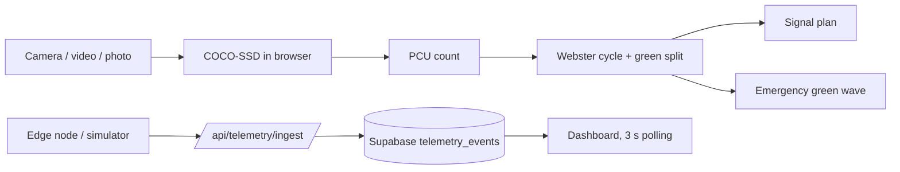

# PulseCity AI

Adaptive traffic-signal timing for Accra, Ghana, driven by in-browser computer vision.
Track: **Traffic Mitigation**.

## Problem

Accra's signalised junctions, such as Kwame Nkrumah Circle, mostly run fixed-time plans.
A fixed plan gives each approach the same green time whatever traffic is actually waiting,
so green is wasted on short queues while long ones grow.

The traffic mix makes this worse. Much of the city's public transport is *trotro* minibuses,
which stop, load and pull out close to intersections. A trotro takes up more road than a car,
so counting vehicles without weighting them understates the load on an approach.

Emergency vehicles wait in the same queues because there is no signal priority.

## Solution

PulseCity AI turns a camera frame into a signal plan:

1. **Detect** vehicles with COCO-SSD (TensorFlow.js) running in the browser. No frames leave the device.
2. **Weight** detections in Passenger Car Units (PCU), so a trotro counts for more than a car.
3. **Time** the junction with F.V. Webster's method: optimum cycle `C0 = (1.5L + 5) / (1 - Y)`,
   green split in proportion to each phase's flow ratio, and Webster's average-delay formula.
4. **Compare** that plan with a fixed 120 s cycle on the same flows and show the delay difference.
   When the fixed plan is oversaturated, the app says so instead of reporting a number.
5. **Clear a corridor** for an ambulance: Dijkstra over a small Accra road graph, with every
   junction on the route set to green.
6. **Log** telemetry from edge nodes (or the included simulator) to Supabase. The dashboard polls it every 3 s.



## What is real vs simulated

| Part | Status | Notes |
|---|---|---|
| Vehicle detection | Real | COCO-SSD `lite_mobilenet_v2` on the sample photos, an uploaded video/image or your webcam. If the model cannot load, placeholder boxes are shown with a **Simulated** badge. |
| Trotro detection | Approximation | COCO-SSD has no "trotro" class; detected `bus` objects are counted as trotros. |
| PCU weights | Assumed | trotro/bus 2.2, truck 3.0, car 1.0, motorcycle 0.5 (typical values, not calibrated for Accra). |
| Flow from one frame | Assumed | Approach flow is estimated as PCU × 120 veh/h; the cross street as 42 % of it. |
| Webster cycle, green split, delay | Real calculation | `src/utils/websterAlgorithm.js`, covered by tests with hand-worked numbers. |
| Fixed-time baseline | Assumed | 120 s cycle, equal split. No published Accra signal plans were available to us. |
| Intersection data on the map | Simulated until telemetry arrives | Starting values are illustrative and labelled; a node switches to "Telemetry" once a packet for it is stored. |
| Traffic signal controllers | Simulated | We have no access to Accra's signal hardware; plans change the on-screen signals only. |
| Green-wave routing | Real calculation | Dijkstra on a hand-built 8-junction graph with approximate distances. Time saved = expected wait at each fixed-time signal (about 17 s). |
| Telemetry storage | Real | Supabase Postgres via the REST API, row-level security, writes only from the server. |
| Node simulator | Simulated data | `hardware/simulate_esp32_node.py` generates synthetic traffic packets and POSTs them like a real node. |
| Assistant chat | AI or rule-based | Gemini through a server proxy when `GEMINI_API_KEY` is set. Otherwise each reply is labelled "Rule-based mode (AI offline)". |
| Junction photos | Real photos, not live feeds | See Image credits. |
| Physical sensor node | Roadmap | Firmware sketches in `hardware/` are not part of the demo. |

## Demo

- Live app: https://pulsecity-ai.vercel.app
- Video (2 min): VIDEO_URL_HERE

## Run locally

Requires Node.js 20.19+ (or 22.12+) and Python 3 (for the simulator only).

```bash
npm install
cp .env.example .env    # fill in the values below
npm run dev             # http://localhost:5173 (serves the api/ handlers too)
```

| Variable | Used for |
|---|---|
| `PULSECITY_SENSOR_TOKEN` | Shared secret that nodes send in `X-Sensor-Token` |
| `SUPABASE_URL`, `SUPABASE_SERVICE_ROLE_KEY` | Telemetry storage (server only) |
| `GEMINI_API_KEY`, `GEMINI_MODEL` | Optional AI mode of the assistant |

Create the table by running `supabase/migrations/001_telemetry.sql` in the Supabase SQL editor
(or with `supabase db push`).

Send telemetry with the node simulator. No physical hardware is required.

```bash
export PULSECITY_SENSOR_TOKEN=<same value as in .env>
python3 hardware/simulate_esp32_node.py --node TR-01 --interval 3
# against the deployed app:
python3 hardware/simulate_esp32_node.py --node TR-01 --once \
  --gateway https://pulsecity-ai.vercel.app/api/v1/telemetry/ingest
```

The ingest API answers 201 when the event is stored and 401 for a wrong token.
It answers 400 for an invalid payload and 503 if the server is missing its token or Supabase settings.

## Tests

```bash
npm test
```

| File | Covers |
|---|---|
| `tests/webster.test.js` | Optimum cycle, green split and Webster delay against hand-worked examples; fixed-vs-Webster comparison including the oversaturated case; PCU weighting |
| `tests/ingest.test.js` | Ingest API: 503 / 401 / 400 / 201 / 502, with Supabase mocked |
| `src/__tests__/` | Emergency routing, vision fallback labelling, telemetry export, rule-based assistant |

## Roadmap

1. Calibrate PCU weights and saturation flows with manual counts at one Accra junction.
2. Fine-tune a detector on local footage so trotros are a class of their own, not `bus`.
3. Count per approach (lane polygons) instead of estimating cross-street flow.
4. Pilot read-only on one junction controller with the relevant authority before any actuation.
5. Sensor node: roadmap (firmware sketches in `hardware/`, not part of the current demo).

## Image credits

- `src/assets/kwame_nkrumah_circle.jpg`: "Kwame Nkrumah Circle, Accra, Ghana 2" by Oluniyi Ajao,
  [Wikimedia Commons](https://commons.wikimedia.org/wiki/File:Kwame_Nkrumah_Circle,_Accra,_Ghana_2.jpg),
  licensed [CC BY-SA 2.0](https://creativecommons.org/licenses/by-sa/2.0/). Unmodified; a still photo, not a live feed.
- `src/assets/tema_motorway_toll.jpg`: "Tema - Accra Motorway toolbooth" by Enock4seth,
  [Wikimedia Commons](https://commons.wikimedia.org/wiki/File:Tema_-_Accra_Motorway_toolbooth.jpeg),
  licensed [CC BY-SA 3.0](https://creativecommons.org/licenses/by-sa/3.0/). Unmodified (resized to 1280 px); a still photo, not a live feed.
